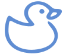

# RDCore
_This document is available in [English](./README.md)_

## Avant de commencer.
> 👋 Bonjour! Nouveau ici? _Rubberduck_ a toujours été une initiative open-source. **RDCore l'honore avec une formule Open-Core**.  
> <small>Voir [rubberduckvba.ca](https://rubberduckvba.ca) pour plus d'informations.</small>

Ce dépôt contient différents projets **en cours de développement** produisant diverses bibliothèques et exécutables, sous une seule licence :

- **Tout ce que contient ce dépôt** est sous licence **⚖️GPLv3 ou toute version ultérieure**. Il est construit sur les paquets [RDCore.SDK](https://github.com/rubberduck-vba/RDCore.SDK), sous licence **⚖️MIT** et publiés sur NuGet.
- **Vos projets vous appartiennent :** le code VBA et RD-VBA que vous écrivez, et tout ce que RDCore en construit, sont à vous, sous la licence de votre choix (voir [NOTICE.md](NOTICE.md)).

Cet arrangement protège les contributeurs historiques et actuels tout en permettant l'avenir : **l'implémentation du runtime RDCore demeurera open-source**.

👉 Nous construisons ici une base solide pour le coeur du langage. Le [site de documentation](https://rubberduck-vba.github.io/RDCore/index.fr.html) reste la référence principale, mais la plateforme produit désormais des livrables réels : `rdc.exe` conduit un workspace du chargement à l'analyse jusqu'à la définition des symboles, résolus à travers les modules par un véritable symbole-resolver ordonné selon MS-VBAL.

<a id="projectstatus"/>

## 📊 Statut du projet
RDCore est en développement actif **alpha**. La **spécification** et la **documentation** sont les livrables stables; la plateforme s'exécute de bout en bout (workspace → parse → symbols → execution) mais n'est pas encore terminée. Elle est publiée en [préversions](https://github.com/rubberduck-vba/RDCore/releases), pour évaluation : voir [Démarrer avec RDCore](https://rubberduck-vba.github.io/RDCore/getting-started.fr.html).

**Contributions**

- Individuelles : ✅ Ouvertes ([CLA](CLA.md))  
- Corporatives : ⏳ Planifié  

| Projet | Rôle | Couverture |
|---|---|---|
| **RDCore.Runtime** | Sémantiques d'exécution RD-VBA + bibliothèque standard |  |
| **RDCore.Runtime.Support** | La session dans laquelle un programme s'exécute, et l'exécuteur que partagent `rdc run` et un programme compilé |  |
| **RDCore.External** | Abstractions du monde extérieur : serveurs d'automation, bibliothèques natives |  |
| **RDCore.External.Windows** | Le monde extérieur sous Windows : automation COM, BSTR/VARIANT et ordinaux des appels natifs |  |
| **RDCore.ParseServer** | Serveur de parsing sans état, autour de RDCore.Parsing |  |
| **RDCore.Parsing** | Le parser VBA : grammaire, arbres syntaxiques |  |
| **RDCore.Symbols** | Symboles du workspace, bâtis des arbres syntaxiques |  |
| **RDCore.CLI** | Client CLI / hôte d'environnement |  |
| **RDCore.LanguageServer** | Coordonnateur de la plateforme |  |
| **RDCore.Diagnostics** | Extension d'inspection de base |  |

✅ Le parser, la résolution de symboles et le **language server** sont fonctionnels. Le serveur répond aux requêtes _diagnostics_ (pull et push),
_completion_, _signature help_, _hover_, _inlay hints_, _semantic tokens_, _document_ et _workspace symbols_, _folding_ et _selection ranges_, _definition_,
_declaration_, _type definition_ et _implementation_, _references_ et _highlights_, _call_ et _type hierarchy_, _rename_ et _code actions_.

---
### Voir aussi
- [Getting Started](https://rubberduck-vba.github.io/RDCore/getting-started.html)
- [CONTRIBUTING.md](CONTRIBUTING.md)
- [CODE_OF_CONDUCT.md](CODE_OF_CONDUCT.md)
- [RD-VBAL](https://rubberduck-vba.github.io/RDCore/specs/rd-vbal.1.0.introduction.html)
- [RDCore.SDK](https://github.com/rubberduck-vba/RDCore.SDK) : le modèle du langage et l'infrastructure commune sur lesquels reposent tous les composants et extensions de RDCore
- [RDCore.HexIDE](https://github.com/rubberduck-vba/RDCore.HexIDE) : le module d'extension qui intègre RDCore à HexIDE
- [HexIDE](https://github.com/hexide-io/HexIDE) : l'IDE conçu pour les développeurs VB, que RDCore.HexIDE étend

> [!NOTE]
> La version française des documents techniques, lorsque disponible, utilise les termes originaux _en anglais_ qui conservent la précision de leur signification, plutôt qu'une traduction approximative qui pourrait facilement être plus confondante qu'utile.

<a href='https://rubberduck-vba.github.io/RDCore/index.fr.html'>ACCUEIL</a> • <a href='https://rubberduck-vba.github.io/RDCore/index.html'>HOME</a>  | ℹ️ <a href='https://rubberduck-vba.github.io/RDCore/introduction.fr.html'>BIENVENUE</a> • <a href='https://rubberduck-vba.github.io/RDCore/introduction.html'>WELCOME</a>  | 🧩 <a href='https://rubberduck-vba.github.io/RDCore/getting-started.fr.html'>BÂTISSONS</a> • <a href='https://rubberduck-vba.github.io/RDCore/getting-started.html'>BUILD</a>  | <a href='https://rubberduck-vba.github.io/RDCore/specs/rd-vbal.html'><strong>RD-VBAL</strong></a>  |  <a href='https://rubberduck-vba.github.io/RDCore.SDK/api/RDCore.SDK.html'>SDK</a>  | 🌐 <a href='https://rubberduckvba.ca'>rubberduckvba.ca</a>

<h6 align='center'>V I V A T ❤️ C U C U M I S ™</h6>

<small>© Copyright <strong>9562-7303 Québec inc.</strong> (2026) <em>Seul, &quot;Rubberduck&quot; est utilisé pour fins de référence au projet open-source legacy <strong>utilisé publiquement ainsi depuis 2015</strong> et sans lien ni affiliation avec tout tiers détenteur d'une marque semblable dans quelque juridiction que ce soit. &quot;Rubberduck VBA&quot;, &quot;RDCore&quot; et &quot;VIVAT CUCUMIS&quot; sont des marques de commerce revendiquées par 9562-7303 Québec inc. (en attente); Toutes les marques appartiennent à leur détenteur respectif. RDCore n'est pas un produit de Microsoft et n'est pas affilié à Microsoft, ni directement, ni indirectement.  If used alone, <em>&quot;Rubberduck&quot; is used as a reference to the legacy open-source project <strong>the same way it has been used publicly since 2015</strong> and without any links or affiliation with any third-party trademark holders of a similar trademark in any jurdisdiction. &quot;Rubberduck VBA&quot;, &quot;RDCore&quot; and &quot;VIVAT CUCUMIS&quot; are trademarks claimed by 9562-7303 Québec inc. (pending). All trademarks belong to their respective owners. RDCore is not a Microsoft product and is not affiliated with Microsoft, directly or indirectly.</small>

