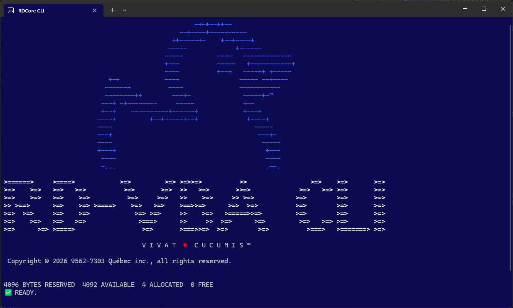

# Démarrer avec RDCore
<sup>_This document is available in [English](getting-started.html)_</sup>

> [!NOTE]
> **La plateforme est en alpha.** Attendez-vous à des aspérités, et à des changements d'une version à l'autre.

---
## Obtenir la plateforme

Téléchargez l'archive de votre système parmi les [versions publiées](https://github.com/rubberduck-vba/RDCore/releases) de RDCore : `rdcore-<version>-win-x64.zip` pour Windows, ou un `.tar.gz` pour Linux et macOS. La plateforme a besoin du [_runtime_ .NET 10](https://dotnet.microsoft.com/download/dotnet/10.0) de l'architecture de votre système.

1. Extrayez l'archive dans un dossier qui lui est propre. Sous Linux et macOS, extrayez-la avec `tar -xzf`, qui conserve le bit d'exécution des programmes. Sous macOS, levez ensuite la quarantaine du dossier : `xattr -dr com.apple.quarantine <dossier>`.
1. Ouvrez un terminal dans le dossier `RDCore.CLI` du dossier extrait et lancez `.\rdc install` (Windows) ou `./rdc install` (Linux et macOS). La commande installe la plateforme pour votre compte d'utilisateur et met `rdc` dans votre PATH (voir [Installer la plateforme](rdc.fr.md#installer-la-plateforme)).
1. Ouvrez un nouveau terminal : `rdc` se lance de n'importe quel dossier. Vous pouvez ensuite supprimer le dossier extrait.

Les programmes ne sont pas signés; sous Windows, SmartScreen peut donc vous en avertir.

Pour plutôt construire la plateforme à partir de son code source, avec le [SDK .NET 10](https://dotnet.microsoft.com/download/dotnet/10.0), voir [Compiler la plateforme à partir des sources](building-on-rdcore.fr.md#compiler-la-plateforme-à-partir-des-sources). `rdc install` installe de la même façon une plateforme que vous avez construite, à partir de son dossier `RDCore.CLI`.

---
## Le _shell_ RD-VBA

Lancez **`rdc`** dans un terminal. Si tout va bien, vous voyez l'écran d'accueil de la plateforme :



Vous voilà quelque part entre le mode programme du _BASIC_ du _Commodore 64_, le volet _exécution_ (_immediate_) du VBIDE, et un éditeur moderne :

- Tapez `HELP` pour la liste des commandes.
- Tapez n'importe quelle instruction RD-VBA pour l'exécuter sur-le-champ : `Debug.Print 6 * 7`.
- Commencez une ligne par un _numéro de ligne_ pour l'écrire dans le _programme courant_ : `10 Debug.Print "Bonjour"`, puis listez-le avec `LIST` et exécutez-le avec `RUN`.

Toutes les commandes du _shell_, et les commandes que `rdc` exécute sans le _shell_, sont dans [Le _shell_ et les commandes rdc](rdc.fr.md).

---
## Apporter un projet VBA

RDCore travaille avec les fichiers sources de votre projet, exportés de l'éditeur VBA. Rubberduck (_legacy_) exporte un projet entier en un clic; le VBIDE exporte un module à la fois, à moins de l'automatiser avec la bibliothèque _VBIDE Extensibility_.

Placez les fichiers exportés dans un dossier à part, puis faites-en un espace de travail RDCore. À partir du dossier `RDCore.CLI` :

```
rdc new <chemin>
```

Cette commande écrit un fichier `.rdproj` dans ce dossier, qui nomme chaque fichier source qu'elle y trouve. Les fichiers qu'elle ne reconnaît pas sont listés sous « autres fichiers » : ils font quand même partie de l'espace de travail, simplement pas du code source.

Ouvrez ensuite le _shell_ sur cet espace de travail avec `rdc --workspace <chemin>`.

Un projet Visual Basic 6 obtient plutôt son `.rdproj` de son `.vbp` : voir [Projets VB6](vb6-projects.fr.md).

---
## Utiliser RDCore à partir d'un IDE

Le _shell_ est amusant, mais le vrai travail se fait dans le serveur de langage derrière lui, et un serveur de langage a besoin d'un éditeur. Nous recommandons **[HexIDE](https://github.com/hexide-io/HexIDE)**, conçu pour les développeurs VB : voir [RDCore dans HexIDE](hexide.fr.md).

---
## Bon à savoir

- **RDCore s'exécute en 64 bits**, alors ce qu'il charge doit l'être aussi :
  - les _UserForms_ requièrent Office 64 bits (Microsoft Forms 2.0 en 64 bits);
  - la bibliothèque d'une instruction `Declare` doit être une DLL 64 bits;
  - l'automatisation d'Office (`CreateObject("Excel.Application")`) requiert que l'application Office soit installée.
- **Vos paramètres** sont conservés dans `%APPDATA%\RDCore`, et les **journaux** dans `%LOCALAPPDATA%\RDCore\Logs`. Rien n'est écrit dans le dossier de la plateforme : mettre à jour, c'est remplacer ce dossier.
- **RDCore parle français et anglais**, et suit la langue d'affichage de votre machine. `CONFIG Environment.Regional.Language en` (ou `fr`) en choisit une au prochain démarrage de RDCore. Ce paramètre ne change pas la façon d'écrire les nombres ni les dates.
- **Vos projets vous appartiennent** : la GPLv3 couvre RDCore lui-même, et non le code que vous écrivez ni ce que RDCore en construit (voir l'[AVIS](https://github.com/rubberduck-vba/RDCore/blob/main/NOTICE.md)).
- **Vous voulez contribuer, ou bâtir sur la plateforme?** Voyez [Bâtir sur RDCore](building-on-rdcore.fr.md).

> [!NOTE]
> La version française des documents techniques, lorsque disponible, utilise les termes originaux _en anglais_ qui conservent la précision de leur signification, plutôt qu'une traduction approximative qui pourrait facilement être plus confondante qu'utile.

---
[ACCUEIL](index.fr.md) • [HOME](./index.md) | ℹ️ [BIENVENUE](introduction.fr.md) • [WELCOME](introduction.html) | 🧩 BÂTISSONS • [BUILD](getting-started.html) | [**RD-VBAL**](/RDCore/specs/rd-vbal.html) | [SDK](https://rubberduck-vba.github.io/RDCore.SDK/api/RDCore.SDK.html) | 🌐 [rubberduckvba.ca](https://rubberduckvba.ca)

---
