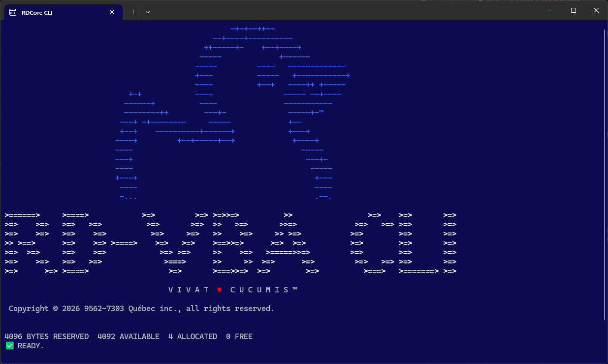

# Getting started with RDCore
<sup>_Ce document est disponible en [français](getting-started.fr.html)_</sup>

> [!NOTE]
> **The platform is pre-alpha.** Expect rough edges, and expect things to change between versions.

---
## Installing the platform

You need the [.NET 10 Runtime](https://dotnet.microsoft.com/download/dotnet/10.0) (x64). You probably have it already: `dotnet --list-runtimes` lists `Microsoft.NETCore.App 10.x` if you do.

1. **Download** `rdcore-<version>-win-x64.zip` from the [GitHub Releases page](https://github.com/rubberduck-vba/RDCore/releases). [rubberduckvba.ca](https://rubberduckvba.ca) downloads the exact same file.
1. **Extract** it wherever you like, `Program Files` included. Keep the extracted folder whole: each part of the platform finds the others from it.

That's it: there's no installer, and nothing to register.

> [!TIP]
> To check the download, also get `SHA256SUMS` from the release. In PowerShell, `(Get-FileHash .\rdcore-<version>-win-x64.zip).Hash` must match the zip's line in it; in Git Bash, `sha256sum -c --ignore-missing SHA256SUMS` checks it for you.

> [!WARNING]
> Preview builds aren't signed yet: SmartScreen may warn about them, and Windows 11's _Smart App Control_ may block them.

---
## The RD-VBA shell

Open the `RDCore.CLI` folder and run **`rdc.exe`**. If all goes well, you'll see the platform's splash screen:



From here you're somewhere between the program mode of _Commodore 64 BASIC_, the _immediate_ pane of the VBIDE, and a modern editor:

- Type `HELP` for the list of commands.
- Type any RD-VBA statement to run it right away: `Debug.Print 6 * 7`.
- Start a line with a _line number_ to write it into the _current program_: `10 Debug.Print "Hello"`.

The current program is the body of an implicit procedure named `Main`, in an implicit module named `Program`. It stays in memory until you `NEW` it, `LOAD` another one, or `EXIT`.

| Command | What it does |
|---|---|
| `LIST` | Shows the program, formatted. `FOLD` folds and unfolds its blocks. |
| `RUN` | Runs it. |
| `SAVE` / `LOAD` | Writes it to, or reads it from, a `.rdc` text file. |
| `BREAK <line#> [<condition>]` | Sets a breakpoint; `BREAK TOGGLE <line#>` turns one off or on again. `CONT` goes on from a stop, and `STEP` runs one statement. |
| `VARS`, `STACK` | Shows the variables and the call stack at a stop. |
| `CONFIG` | Shows and edits your settings, with completion. Formatting changes apply right away. |

At a stop you can type statements as you would in the VBIDE's immediate pane, and edit the program before you go on.

> [!NOTE]
> The shell is a demo and a way to try the platform, not an IDE. It doesn't handle a project with more than one procedure scope, or BASIC-style line numbers in your own modules.

---
## Bringing a VBA project over

RDCore works with your project's source files, exported from the VBA editor. Legacy Rubberduck exports a whole project in one click; the VBIDE exports one module at a time, unless you script it against the _VBIDE Extensibility_ library.

Put the exported files in a folder of their own, then make it an RDCore workspace. From the `RDCore.CLI` folder:

```
rdc new <path>
```

This writes a `.rdproj` file into that folder, naming each source file it finds. Files it doesn't recognize are listed under "other files": they're still part of the workspace, just not source code.

Then open the shell on it with `rdc --workspace <path>`.

---
## Using RDCore from an IDE

The shell is fun, but the real work happens in the language server behind it, and a language server needs an editor. We recommend **[HexIDE](https://github.com/hexide-io/HexIDE)**: unlike most editors, it was made for VB developers, so you'll feel right at home.

> [!NOTE]
> HexIDE support for RDCore is under development, in the [RDCore.HexIDE](https://github.com/rubberduck-vba/RDCore.HexIDE) add-in.

---
## Good to know

- **RDCore is a 64-bit process**, so what it loads must be 64-bit too:
  - UserForms need 64-bit Office (the 64-bit Microsoft Forms 2.0);
  - a `Declare` statement's library must be a 64-bit DLL;
  - Office automation (`CreateObject("Excel.Application")`) needs the Office application installed.
- **Your settings** are kept in `%APPDATA%\RDCore`, and the **logs** in `%LOCALAPPDATA%\RDCore\Logs`. Nothing is written into the folder you extracted, so updating means replacing that folder.
- **Your projects are yours**: the GPLv3 covers RDCore itself, not the code you write or what RDCore builds from it (see [NOTICE.md](https://github.com/rubberduck-vba/RDCore/blob/main/NOTICE.md)).
- **Want to contribute, or build on the platform?** See [Building on RDCore](building-on-rdcore.md).

---
[ACCUEIL](index.fr.md) • [HOME](index.md) | ℹ️ [BIENVENUE](introduction.fr.md) • [WELCOME](introduction.html) | 🧩 [BÂTISSONS](getting-started.fr.md) • BUILD | [**RD-VBAL**](/RDCore/specs/rd-vbal.html) | [SDK](/RDCore/api/RDCore.SDK.Model.Errors.VBCompileErrorId.html) | 🌐 [rubberduckvba.ca](https://rubberduckvba.ca)

---
