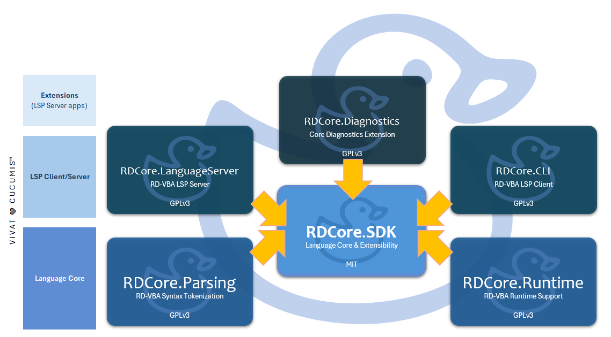

# Introduction 
_This document is available in [English](introduction.html)_

**RDCore™** est un **projet open-source** conçu et soutenu par une société privée et visant à bâtir une plateforme de langage moderne pour _Visual Basic for Applications_ (VBA).
À terme, son SDK fournit un modèle sémantique complet, infrastructure run-time, et surface d'outillage extensible pour analyser, exécuter, et faire évoluer le code VBA **à l'extérieur de son environnement historique**.

---
## L'idée

Pensez **Roslyn, mais pour VBA**.

RDCore réimagine VBA en tant que plateforme de langage de première classe:
- Un modèle sémantique détaillé
- Un runtime découplé des environnements legacy
- Une architecture modulaire conçue pour l'extensibilité
- Une fondation pour l'outillage, l'analyse, et l'exécution

RDCore vise à développer une plateforme pérenne et extensible pour comprendre et faire évoluer le langage.

VBA n'est pas qu'un runtime vieillissant - c'est aussi une _spécification de langage_. RDCore le traite simplement comme tel.

---
## Architecture

- **Les librairies RDCore.SDK et RDCore.SDK.Protocol** sont sous licence  **MIT**;
- **Tout le reste** construit par-dessus, est sous licence **GPLv3 ou ultérieure**.

RDCore est constitué de :
- **RDCore.SDK** (MIT) définit le _modèle du langage_ : arbres syntaxiques, symboles, modèle sémantique, système de typage, etc. C'est un paquet NuGet, développé dans [son propre dépôt](https://github.com/rubberduck-vba/RDCore.SDK), avec sa [référence d'API](https://rubberduck-vba.github.io/RDCore.SDK/) (en anglais).
- **RDCore.SDK.Protocol** (MIT) est ce qu'un client parle à la plateforme : ses messages `rdcore/*`, la poignée de main, et comment démarrer le serveur de langage, avec la seule bibliothèque de base .NET.
- **RDCore.Runtime.LanguageCore** (GPLv3 ou ultérieure) est le _coeur de langage_ : la liaison des noms, la sémantique statique, le jeu d'instructions et les déclarations de la bibliothèque standard.
- **RDCore.Runtime** (GPLv3 ou ultérieure) implémente les abstractions définies par le SDK autour des sémantiques run-time, la librairie standard, etc.
- **Hôtes** (GPLv3 ou ultérieure) incluant un client CLI (rdc.exe), un serveur LSP et les applications satellites lui permettant de manipuler et de comprendre le langage (parser, diagnostics, etc.).

---
## Ce que RDCore rend possible
- Analyse sémantique profonde de code VBA
- Exécution de code VBA hors du VBIDE
- Outillage langage via le protocole _Language Server_ (LSP)
- Inspection du comportement à l'exécution, faits sémantiques 
- Extension de la plateforme avec des analyseurs et plug-ins

---
## Statut du projet
RDCore est présentement en phase active de développement **alpha**.

Le **statut courant du projet** est tenu à jour dans **README.md** aux côtés de l'implémentation de la plateforme dans le [référentiel sur GitHub](https://github.com/rubberduck-vba/RDCore).

---
[ACCUEIL](index.fr.md) • [HOME](index.md) | ℹ️ BIENVENUE • [WELCOME](introduction.html) | 🧩 [BÂTISSONS](getting-started.fr.md) • [BUILD](getting-started.html) | [**RD-VBAL**](/RDCore/specs/rd-vbal.html) | [SDK](https://rubberduck-vba.github.io/RDCore.SDK/api/RDCore.SDK.html) | 🌐 [rubberduckvba.ca](https://rubberduckvba.ca)

---
