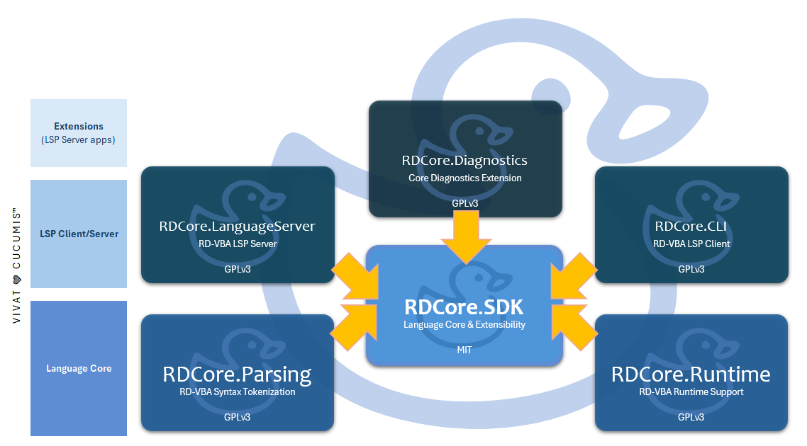

# Introduction 
_Ce document est disponible en [français](introduction.fr.html)_

**RDCore™** is an **open-source project** engineered and maintained by a private company, aiming to build a modern language platform for _Visual Basic for Applications_ (VBA).  
It ultimately provides a complete semantic model, runtime infrastructure, and extensible tooling surface to analyze, execute, and evolve VBA code **outside of its historical environment**.

---
## The idea

Think **Roslyn, but for VBA**.  

RDCore reimagines VBA as a first-class language platform:
- A detailed semantic model
- A runtime decoupled from legacy environments
- A modular architecture built around extensibility
- A foundation for tooling, analysis, and execution

RDCore aims to to provide a sustainable, extensible platform for understanding and evolving the language.

VBA is not just a legacy runtime - it is a _language specification_. RDCore simply treats it as such.

---
## Architecture

- **The RDCore.SDK and RDCore.SDK.Protocol libraries** are licensed under **MIT**;
- **Everything else** built around it is licensed under **GPLv3 or later**.

RDCore is composed of:
- **RDCore.SDK** (MIT) defines the _language model_: syntax trees, symbols, semantic model, type system, etc. It is a NuGet package, built in [its own repository](https://github.com/rubberduck-vba/RDCore.SDK), with its [API reference](https://rubberduck-vba.github.io/RDCore.SDK/).
- **RDCore.SDK.Protocol** (MIT) is what a client speaks to the platform with: its `rdcore/*` messages, the handshake, and how to start the language server, over the .NET base library alone.
- **RDCore.Runtime.LanguageCore** (GPLv3 or later) is the _language core_: name binding, static semantics, the instruction set, and the standard library's declarations.
- **RDCore.Runtime** (GPLv3 or later) implements SDK-defined abstractions around runtime semantics, the standard library, etc.
- **Hosts** (GPLv3 or later) include a CLI client (rdc.exe), a LSP server, and other applications that orchestrate execution and interactions.

---
## What RDCore Enables
- **Analyze VBA code** at depths only _LSP analyzers_ can reach
- **Execute** VBA code outside the VBIDE
- **Build dev tools** via the _Language Server Protocol_ (LSP)
- **Inspect runtime** behavior and semantic facts
- **Extend the platform** with analyzers and plugins

---
## Project Status
RDCore is currently in active **alpha** development.  

The current **project status** is kept up-to-date in **README.md** alongside its implementation in the [GitHub repository](https://github.com/rubberduck-vba/RDCore).

---
[ACCUEIL](index.fr.md) • [HOME](index.md) | ℹ️ [BIENVENUE](introduction.fr.md) • WELCOME | 🧩 [BÂTISSONS](getting-started.fr.md) • [BUILD](getting-started.html) | [**RD-VBAL**](/RDCore/specs/rd-vbal.html) | [SDK](https://rubberduck-vba.github.io/RDCore.SDK/api/RDCore.SDK.html) | 🌐 [rubberduckvba.ca](https://rubberduckvba.ca)

---
